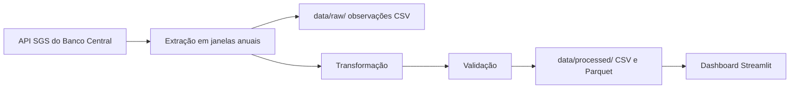

# Indicadores Econômicos do Brasil

Pipeline e painel interativo para acompanhar indicadores do Banco Central do Brasil. A coleta usa a API pública do Sistema Gerenciador de Séries Temporais (SGS), sem chave de acesso.

## Indicadores

| Indicador | Código SGS | Frequência | Transformação |
|---|---:|---|---|
| Meta Selic | 432 | Diária | Último valor do mês na tabela mensal |
| IPCA mensal | 433 | Mensal | Variação percentual mensal |
| Dólar venda (R$/US$) | 1 | Diária | Média mensal e média móvel de 30 observações |

O pipeline também calcula o IPCA acumulado em 12 meses por composição das variações mensais.

## Começar

Requisitos: Python 3.11 ou superior e conexão à internet para coletar os dados.

No PowerShell, na pasta do projeto:

```powershell
python -m venv .venv
.\.venv\Scripts\Activate.ps1
python -m pip install -e . pytest ruff
python -m bcb_pipeline.cli run
streamlit run app/dashboard.py
```

O pipeline consulta o histórico desde 2000 por padrão. Para limitar o intervalo:

```powershell
python -m bcb_pipeline.cli run --start-date 2020-01-01 --end-date 2026-09-30
```

O painel abre no navegador e lê os arquivos processados locais. Para atualizar os dados manualmente, execute novamente o pipeline e use **Recarregar dados** no painel.

## Fluxo



## Dashboard

O painel permite escolher o período e os indicadores. Exibe KPIs, gráficos Plotly, tabela e download dos dados filtrados em CSV.

A captura do dashboard está pendente. Salve a imagem em `docs/dashboard.png` para incluí-la aqui.

## Testes e qualidade

Os testes usam respostas locais e não acessam a rede. Para executá-los e verificar o estilo:

```powershell
pytest
ruff check .
ruff format --check .
```

O workflow de CI executa esses três comandos em pull requests e atualizações das branches `main` e `master`.

## Atualização semanal

O GitHub Actions coleta os dados toda segunda-feira às 09:00 no horário de Brasília e salva um commit quando os arquivos processados mudam. Também é possível iniciar a execução em **Actions → Refresh processed data → Run workflow**.

## Decisões técnicas

- A API SGS é pública e não requer credenciais.
- As consultas são separadas por ano civil. Isso mantém as janelas muito abaixo do limite de 10 anos para consultas diárias e evita repetir observações mensais nas fronteiras.
- Falhas HTTP e de conexão são repetidas com backoff exponencial; as consultas usam timeout.
- Dados brutos ficam em `data/raw/` e não são versionados. As tabelas processadas em CSV e Parquet ficam em `data/processed/` e são versionadas para permitir abrir o dashboard após clonar o repositório.
- A validação interrompe o pipeline diante de nulos, datas duplicadas ou valores fora das faixas plausíveis. Dados defasados geram avisos.
- O dashboard só lê dados locais processados; ele não chama a API.
- A atualização semanal usa o `GITHUB_TOKEN` padrão do Actions, limitado à escrita no conteúdo deste repositório. Nenhum segredo externo é necessário.

Fontes: [API de dados SGS](https://api.bcb.gov.br/dados/serie/bcdata.sgs.432/dados?formato=json&dataInicial=01%2F01%2F2024&dataFinal=05%2F01%2F2024) · [Limite de consultas diárias no portal do BCB](https://dadosabertos.bcb.gov.br/dataset/1-taxa-de-cambio---livre---dolar-americano-venda---diario).

